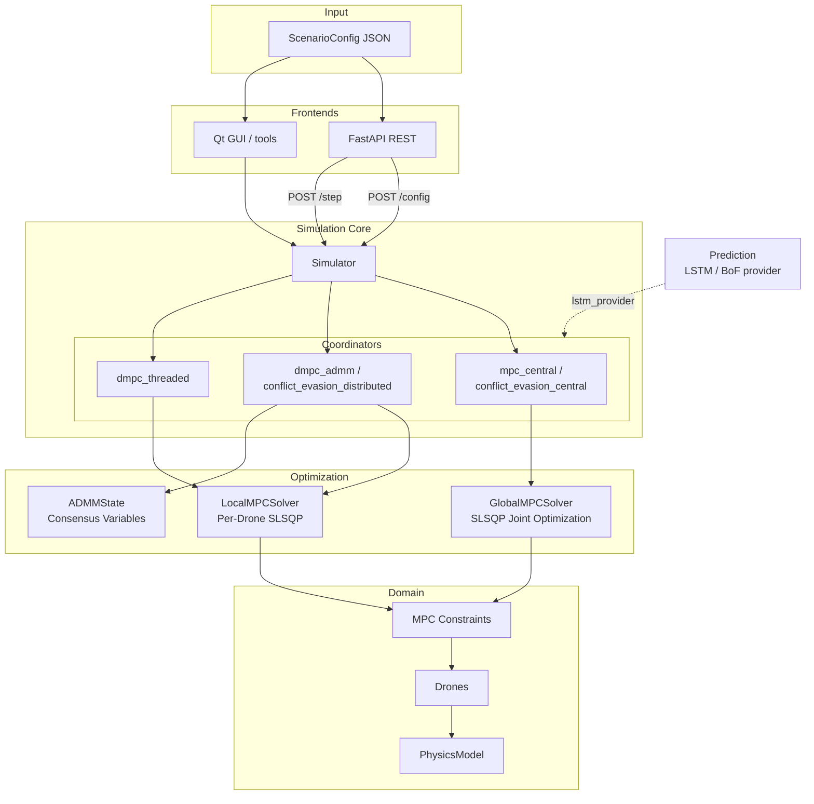
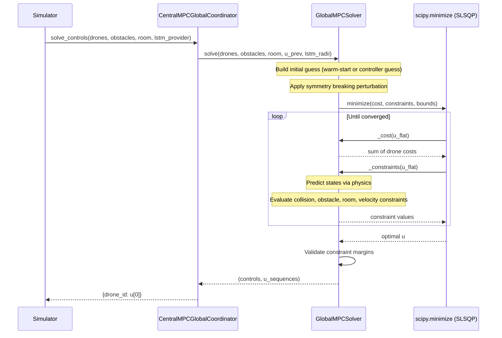
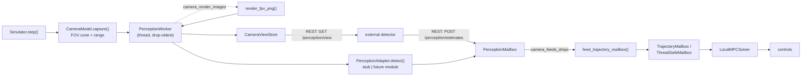

# TLCAmpc Architecture

This document describes the architecture and class structure of the **TLCAmpc** (Time-Linked Collision Avoidance MPC) drone simulation system.

## Overview

The system is a 3D drone simulation framework implementing Model Predictive Control (MPC) for collision avoidance. It supports **centralized MPC**, **distributed MPC with ADMM consensus** (sequential or threaded), conflict-evasion variants of both, and three kinds of safety zones: fixed, velocity-dependent (adaptive) and uncertainty-based (LSTM or BoF prediction).

## Package Structure

```
src/drone_sim/
├── domain/          # Core domain models, configuration, constraints, registry
│   └── utils/       # Small helpers (e.g. all_drones_reached_destination)
├── physics/         # Physics models for drone dynamics
├── controllers/     # Per-drone MPC cost models
├── simulation/      # Simulation orchestration (Simulator)
│   ├── centralized/ # Central MPC coordinator (+ conflict-evasion variant)
│   ├── distributed/ # ADMM-based DMPC, sequential and threaded (+ conflict-evasion variant)
│   └── utils/       # Conflict detection, CPU-time ledger
├── prediction/      # LSTM / BoF trajectory prediction for uncertainty-based safety zones
├── gui/             # Qt desktop viewer: live simulation and CSV replay
├── api/             # FastAPI REST interface and PNG rendering
│   └── utils/       # render_helper (matplotlib drawing)
└── perception/      # Camera perception pipeline — NOT MERGED INTO MAIN YET (see "Perception Pipeline")
```

## Class Diagram

```mermaid
classDiagram
    direction TB

    %% ===== DOMAIN LAYER =====
    class Drone {
        +drone_id: str
        +radius: float
        +safety_zone: float
        +cons_stop: float
        +alpha: float | None
        +safety_zone_mode: str
        +color / safety_color / trace_color
        +controller: Controller
        +physics: PhysicsModel
        +x: ndarray
        +route: Route
        +v_max: float  (property)
        +is_adaptive: bool  (property)
        +position() ndarray
        +velocity() ndarray
        +predict(u) ndarray
        +bounds() tuple
        +compute_adaptive_radius(velocity) float
        +compute_max_adaptive_radius() float
        +compute_terminal_radius(velocity) float
    }
    class Route {
        +waypoints: list
        +target: ndarray
        +waypoint_radius: float
        +idx: int
        +current_ref() ndarray
        +advance_if_reached(position)
        +target_reached(position, thresh) bool
    }
    class ScenarioConfig {
        +dt: float
        +physics: PhysicsSpec | list~PhysicsSpec~
        +controller: ControllerSpec
        +coordinator: ControllerSpec | None
        +comm_radius: float | None
        +drones: list~DroneConfig~
        +obstacles: list~ObstacleConfig~
        +room: RoomConfig | None
        +lstm_model_path / lstm_look_ahead
        +bof_enabled / bof_backend / bof_url / ...
    }
    class DroneConfig {
        +drone_id: str
        +start: list
        +target: list
        +waypoints: list
        +controller: ControllerSpec | None
        +physics: str | None
        +radius: float
        +safety_zone: float
        +cons_stop: float
        +alpha: float | None
        +safety_zone_mode: str
        +drone_color / safety_color / trace_color
    }
    class registry {
        +PHYSICS: dict
        +CONTROLLERS: dict
        +COORDINATORS: dict
        +register_physics(name)
        +register_controller(name)
        +register_coordinator(name)
        +create_physics(spec)
        +create_controller(spec)
        +create_coordinator(spec)
    }

    Drone --> Route : has
    Drone --> Controller : uses
    Drone --> PhysicsModel : uses
    ScenarioConfig --> DroneConfig : contains
    registry ..> PhysicsModel : creates
    registry ..> Controller : creates
    registry ..> CentralMPCGlobalCoordinator : creates
    registry ..> DistributedMPCCoordinator : creates
    registry ..> ThreadedMPCCoordinator : creates

    %% ===== PHYSICS LAYER =====
    class PhysicsModel {
        +dt: float
        +v_max() float
        +step(x, u) ndarray
        +predict_trajectory(x0, u_seq) tuple
        +central_bounds() tuple
    }
    class LinearKinematicsPhysics {
        +A: ndarray
        +B: ndarray
        +step(x, u) ndarray
        +clip_velocity(vel) ndarray
        +predict_trajectory(x0, u_seq) tuple
    }

    PhysicsModel <|-- LinearKinematicsPhysics

    %% ===== CONTROLLER LAYER =====
    class Controller {
        +control(drone, neighbors, obstacles) ndarray
    }
    class CentralCostProvider {
        <<protocol>>
        +dt: float
        +central_initial_guess(drone) ndarray
        +central_cost(u_seq, drone) float
    }
    class CentralMPCAgent {
        +dt: float
        +horizon: int
        +q_pos: list
        +q_vel: list
        +r_u: list
        +central_cost(u_seq, drone) float
        +central_initial_guess(drone) ndarray
    }
    class AdaptiveMPCAgent {
        +lambda_vel: float
        +central_cost(u_seq, drone) float
    }

    Controller <|-- CentralMPCAgent
    CentralCostProvider <|.. CentralMPCAgent
    CentralMPCAgent <|-- AdaptiveMPCAgent

    %% ===== CONSTRAINTS =====
    class MPCConstraints {
        <<abstract>>
        #_horizon: int
        +label() str
    }
    class VelocityConstraints {
        +evaluate_single(drone, v_pred, values) ndarray
        +evaluate_multi(drones, v_pred, values) ndarray
    }
    class MovingObstacleAvoidanceConstraints {
        +terminal_constraint: bool
        +evaluate_single(drone, pred_pos, neighbors, values, pred_vel, ...) ndarray
        +evaluate_multi(drones, pred_pos, values, pred_vel, ...) ndarray
    }
    class ObstacleAvoidanceConstraints {
        +terminal_constraint: bool
        +evaluate_single(drone, pred_pos, obstacles, values, pred_vel) ndarray
        +evaluate_multi(drones, pred_pos, obstacles, values, pred_vel) ndarray
    }
    class RoomConstraints {
        +wall_tolerance: float
        +terminal_constraint: bool
        +evaluate_single(drone, pred_pos, room_max, room_min, values, room_is_sphere, pred_vel) ndarray
        +evaluate_multi(drones, pred_pos, room_max, room_min, values, ...) ndarray
    }

    MPCConstraints <|-- VelocityConstraints
    MPCConstraints <|-- MovingObstacleAvoidanceConstraints
    MPCConstraints <|-- ObstacleAvoidanceConstraints
    MPCConstraints <|-- RoomConstraints

    %% ===== SIMULATION LAYER =====
    class Simulator {
        +dt: float
        +drones: list
        +obstacles: list
        +room_min: ndarray
        +room_max: ndarray
        +coordinator: object
        +infeasible: bool
        +infeasible_reason: str | None
        +traces: dict
        +last_collisions: list
        +t: float
        +step_count: int
        +compute_time_s: float
        +costs: CpuCostLedger
        +from_config(cfg) Simulator
        +step()
        +to_dict() dict
    }
    class CpuCostLedger {
        +seconds: dict
        +counts: dict
        +timings: dict
        +maxima: dict
        +phase(name)
    }

    Simulator --> Drone : manages
    Simulator --> CpuCostLedger : shares with coordinator
    Simulator --> CentralMPCGlobalCoordinator : uses
    Simulator --> DistributedMPCCoordinator : uses
    Simulator --> ThreadedMPCCoordinator : uses

    %% ===== CENTRALIZED MPC =====
    class CentralMPCGlobalCoordinator {
        +dt: float
        +horizon: int
        +max_iter: int
        +f_tol: float
        +room_wall_tolerance: float
        +terminal_constraint: bool
        +terminal_constraint_pairs: bool
        +terminal_constraint_obstacles: bool
        +symmetry_break_accel: float
        +solve_controls(drones, obstacles, room_min, room_max, lstm_provider) dict
    }
    class ConflictEvasionCentralCoordinator {
        +comm_radius: float | None
        +solve_controls(...) dict
    }
    class GlobalMPCSolver {
        +dt: float
        +horizon: int
        +max_iter: int
        +f_tol: float
        +solve(drones, obstacles, room_min, room_max, u_prev, lstm_radii) tuple
        -_cost(u_flat, drones, controllers) float
        -_constraints(u_flat, drones, obstacles, room) ndarray
        -_predict_states(drones, u) ndarray
        -_validate_constraint_margins(...)
    }

    CentralMPCGlobalCoordinator <|-- ConflictEvasionCentralCoordinator
    CentralMPCGlobalCoordinator --> GlobalMPCSolver : uses
    ConflictEvasionCentralCoordinator --> ConflictDetector : uses
    GlobalMPCSolver --> MPCConstraints : uses

    %% ===== DISTRIBUTED MPC =====
    class DistributedMPCCoordinator {
        +dt: float
        +horizon: int
        +rho: float
        +max_admm_iter: int
        +primal_tol: float
        +dual_tol: float
        +comm_radius: float | None
        +gauss_seidel: bool
        +stagnation_limit: int
        +terminal_constraint(_pairs/_obstacles): bool
        +solve_controls(drones, obstacles, room_min, room_max, lstm_provider) dict
        +get_last_iteration_count() int
        +get_last_residuals() tuple
        +get_last_converged() bool
        +get_neighbor_pairs() list
    }
    class ConflictEvasionDistributedCoordinator {
        +solve_controls(...) dict
    }
    class ThreadedMPCCoordinator {
        +dt: float
        +horizon: int
        +comm_radius: float | None
        +convergence_threshold: float
        +max_iterations: int
        +convergence_timeout_sec: float
        +gauss_seidel: bool
        +solve_controls(...) dict
    }
    class AsyncLocalSolver {
        one thread per drone
    }
    class ThreadSafeMailbox
    class ThreadLifecycleManager
    class LocalMPCSolver {
        +dt: float
        +horizon: int
        +max_iter: int
        +f_tol: float
        +symmetry_break_eps: float
        +solve(drone, neighbor_trajectories, obstacles, room_min, room_max, u_prev, lstm_radii) tuple
        -_predict_states(drone, u) tuple
        -_infeasible_fallback(...) tuple
    }
    class NeighborGraph {
        +comm_radius: float | None
        +update(positions)
        +get_neighbors(drone_id) set
        +get_neighbor_pairs() list
    }
    class ADMMState {
        +rho: float
        +primal_tol: float
        +dual_tol: float
        +horizon: int
        +initialize(neighbor_pairs)
        +update_z(pair, traj_i, traj_j, min_dist)
        +update_lambda(pair, traj_i, traj_j)
        +is_converged(trajectories) bool
        +compute_residuals(trajectories) tuple
    }
    class TrajectoryMailbox {
        +broadcast(sender_id, trajectory, predicted_velocities, timestamp, neighbor_graph)
        +receive(receiver_id) dict
        +clear()
    }
    class TrajectoryMessage {
        +drone_id: str
        +trajectory: ndarray
        +predicted_velocities: ndarray | None
        +timestamp: int
        +safety_zone_radius: float | ndarray | None
    }

    DistributedMPCCoordinator <|-- ConflictEvasionDistributedCoordinator
    ConflictEvasionDistributedCoordinator --> ConflictDetector : uses
    DistributedMPCCoordinator --> LocalMPCSolver : creates per drone
    DistributedMPCCoordinator --> NeighborGraph : uses
    DistributedMPCCoordinator --> ADMMState : uses
    DistributedMPCCoordinator --> TrajectoryMailbox : uses
    ThreadedMPCCoordinator --> AsyncLocalSolver : one per drone
    ThreadedMPCCoordinator --> ThreadSafeMailbox : uses
    ThreadedMPCCoordinator --> ThreadLifecycleManager : uses
    AsyncLocalSolver --> LocalMPCSolver : wraps
    LocalMPCSolver --> MPCConstraints : uses
    TrajectoryMailbox --> TrajectoryMessage : stores

    %% ===== API LAYER =====
    class FastAPIApp {
        +/health GET
        +/config POST
        +/step POST
        +/state GET
        +/render GET
        +/swagger GET
    }
    class StateResponse {
        +t: float
        +dt: float
        +room: RoomState
        +drones: list
        +obstacles: list
        +collisions: list
        +admm_stats: ADMMStats | None
    }

    FastAPIApp --> Simulator : manages
```



## Component Overview

### 1. Domain Layer (`domain/`)

| Class | Purpose |
|-------|---------|
| `Drone` | Core entity: state `x = [x, y, z, vx, vy, vz]`, physics, controller, route, safety-zone parameters. `v_max` and `bounds()` delegate to the physics model |
| `Route` | Manages waypoints and target positions for navigation |
| `ScenarioConfig` | Pydantic model of a JSON scenario file (see "Configuration") |
| `DroneConfig` | Per-drone configuration (start, target, safety zone, colors, ...) |
| `ObstacleConfig` / `RoomConfig` | Axis-aligned obstacle boxes; axis-aligned room box |
| `registry` | Factory pattern: physics, controllers and coordinators are registered by name with `@register_*` and created from `{"type", "params"}` specs |

### 2. Physics Layer (`physics/`)

| Class | Purpose |
|-------|---------|
| `PhysicsModel` | Base class (plain class, not an ABC) holding `dt`, `v_max`, `u_min`, `u_max`; `step()` raises `NotImplementedError` |
| `LinearKinematicsPhysics` | Discrete-time constant-acceleration model (x_{k+1} = Ax_k + Bu_k), registered as `linear_kinematics`. `step()` does not clip; `v_max` is enforced only by `VelocityConstraints` in the solver |

### 3. Controllers Layer (`controllers/`)

| Class | Registry name | Purpose |
|-------|---------------|---------|
| `Controller` | — | Base dataclass for per-drone controllers (`control(drone, neighbors, obstacles)`) |
| `CentralMPCAgent` | `mpc_agent` | Per-drone MPC cost (tracking + velocity + control effort), summed by the coordinators |
| `AdaptiveMPCAgent` | `mpc_agent_adaptive` | Adds `lambda_vel * ‖v‖²` per step, encouraging deceleration so adaptive zones shrink |

### 4. Constraints (`domain/constraints.py`)

| Class | Purpose |
|-------|---------|
| `VelocityConstraints` | Enforces `‖v‖ ≤ v_max` at every horizon step |
| `MovingObstacleAvoidanceConstraints` | Inter-drone collision avoidance (distance ≥ sum of safety radii + `cons_stop`); optional terminal row per pair (`terminal_constraint_pairs`) |
| `ObstacleAvoidanceConstraints` | Static obstacle boxes via the smooth `points_to_box_dist`; optional terminal row per obstacle (`terminal_constraint_obstacles`) |
| `RoomConstraints` | Safety sphere stays inside the room; extra terminal-radius row per drone at the last horizon step (`terminal_constraint`, default on). The class also supports a spherical room (`room_is_sphere`), but `RoomConfig` and the simulator only provide box rooms, so this path is not reachable from a config |

All three terminal switches use `Drone.compute_terminal_radius` (base radius + full stopping distance + half a sampling step), so braking to a standstill stays a feasible continuation of every plan. The safety radius per step comes from `_safety_radii`: fixed, adaptive or LSTM/BoF (see "Safety Zones").

### 5. Simulation Layer (`simulation/`)

#### Core
| Class | Purpose |
|-------|---------|
| `Simulator` | Main orchestrator: builds everything from a `ScenarioConfig`, runs time steps, checks collisions, keeps traces. A coordinator is required: `step()` raises if `coordinator` is `None`. If the coordinator raises `RuntimeError`, the step is marked `infeasible` and time does not advance |

#### Centralized MPC (`simulation/centralized/`)
| Class | Registry name | Purpose |
|-------|---------------|---------|
| `CentralMPCGlobalCoordinator` | `mpc_central` | Wraps `GlobalMPCSolver`, keeps `_u_prev` for warm starts, provides `solve_controls()` |
| `ConflictEvasionCentralCoordinator` | `conflict_evasion_central` | Detects adaptive-zone drones on a collision course (`ConflictDetector`) before the solve; the lower `drone_id` deflects via a temporary evasion waypoint |
| `GlobalMPCSolver` | — | Joint SLSQP optimization over all drones, validates constraint margins afterwards |

#### Distributed MPC (`simulation/distributed/`)
| Class | Registry name | Purpose |
|-------|---------------|---------|
| `DistributedMPCCoordinator` | `dmpc_admm` | ADMM-based coordinator, sequential. Gauss-Seidel by default (random order in the first iterations for symmetry breaking), Jacobi with `gauss_seidel=False`; stops early after `stagnation_limit` iterations without progress |
| `ConflictEvasionDistributedCoordinator` | `conflict_evasion_distributed` | Like the central variant, but both drones of a conflict deflect independently (z-velocity reflection) |
| `ThreadedMPCCoordinator` | `dmpc_threaded` | One `AsyncLocalSolver` thread per drone, exchanging trajectories asynchronously until convergence, `max_iterations` or `convergence_timeout_sec` |
| `LocalMPCSolver` | — | Per-drone SLSQP solver (neighbors as moving obstacles); returns `(u_opt, traj_opt, feasible, vel_opt)` |
| `NeighborGraph` | — | Tracks which drones are within `comm_radius` (all-to-all when `None`) |
| `ADMMState` | — | Dual variables (λ) and auxiliary variables (z) per neighbor pair |
| `TrajectoryMailbox` / `ThreadSafeMailbox` | — | Message passing for trajectory exchange (sequential / threaded) |
| `ThreadLifecycleManager` | — | Starts and stops the solver threads of `dmpc_threaded` |

#### Utilities (`simulation/utils/`)
| Class | Purpose |
|-------|---------|
| `ConflictDetector` | Time-to-collision based conflict detection for the conflict-evasion coordinators |
| `CpuCostLedger` | CPU time per phase (`setup`, `cost`, `constraints`, `solver`, `physics`, ...) and evaluation counters; shared by simulator, coordinator and solvers and exported to `metrics.csv` by `tools/utility/printer.py` |

### 6. Prediction Layer (`prediction/`)

Provides per-step safety radii for `safety_zone_mode: "lstm"` from predicted neighbor trajectories.

| Class | Purpose |
|-------|---------|
| `TrajectoryHistoryBuffer` | Rolling history of positions and velocities per drone |
| `LSTMModelLoader` / `AVLSTMModel` | Loads the trained LSTM checkpoint (`lstm_model_path`) |
| `UncertaintyPropagator` | Turns predicted σ into radii |
| `LSTMSafetyZoneProvider` | Supplies the coordinators with per-step LSTM radii |
| `BoFSafetyZoneProvider` | Alternative provider based on the BoF predictor (`bof_enabled`) |
| `BoFLibraryAdapter` / `BoFRestAdapter` | BoF in-process or via a REST endpoint (`bof_backend`) |
| `AVLSTMTrainer`, `DataGenerator`, `TrajectoryDataset` | Training and synthetic data (used by `tools/train_lstm.py`, `tools/generate_data.py`) |

The simulator passes the active provider (BoF wins over LSTM) to `solve_controls(..., lstm_provider=...)`.

### 7. GUI (`gui/`)

| Class | Purpose |
|-------|---------|
| `MainWindow` | Qt window with 3D view, controls and screenshot export (`python -m drone_sim.gui`) |
| `SimulationBackend` | Interface between window and data source (`SimState`, `StepResult`, `DroneState`, `PredictedTrajectory`) |
| `DirectBackend` | Runs a `Simulator` in-process |
| `ReplayBackend` | Replays a recorded per-step CSV (`drone_id, t, x, y, z, vx, vy, vz`) against the scenario JSON, nothing is simulated |

### 8. API Layer (`api/`)

| Component | Purpose |
|-----------|---------|
| `app.py` | FastAPI application: `/health`, `/config`, `/step`, `/state`, `/render`, `/swagger` |
| `schemas.py` | Pydantic request/response models (`StateResponse`, `DroneState`, `ObstacleState`, `CollisionEvent`, `ADMMStats`, ...) |
| `render.py` | Matplotlib-based PNG rendering |
| `utils/render_helper.py` | Drawing helpers shared by REST rendering and `tools/live_view.py` |
| `perception_router.py` | **Not merged into main yet.** Perception endpoints: the detector pulls camera images and pushes position estimates |

### 9. Perception Layer (`perception/`) — not merged into main yet

> **Not merged into main yet.** The perception package lives on `pratham/working_branch` (last commit 11 Aug 2026). Neither `main` nor the current feature branches contain `src/drone_sim/perception/`, `api/perception_router.py`, the `camera_*` config fields, `configs/perception/` or `tests/drone_sim/perception/`. The description below refers to that branch.

| Class | Purpose |
|-------|---------|
| `CameraModel` | Geometric visibility test (FOV cone + range) producing a `CameraView` per drone |
| `CameraView` / `VisibleDrone` | What one drone's camera sees at one step, optionally with a rendered PNG |
| `render_fpv_png` | Pinhole rasterizer (PIL): spheres, .obj meshes and obstacles, painter's algorithm |
| `PerceptionAdapter` | Protocol `detect(view) -> list[PositionEstimate]` — the seam an external detector plugs into |
| `StubPerceptionAdapter` | In-process stand-in: true positions of the visible neighbors plus optional Gaussian noise |
| `PerceptionWorker` | Runs render + detect off the simulation thread; drop-oldest queue, never blocks `step()` |
| `PerceptionMailbox` | Latest estimate and short history per (observer, observed) pair |
| `CameraViewStore` | One current `CameraView` per drone, waiting to be fetched over REST |
| `feed_trajectory_mailbox` | Bridge: turns estimates into extrapolated neighbor trajectories in the DMPC mailboxes |

## Data Flow Diagram



## MPC Optimization Flow

### Centralized MPC



### Distributed MPC (ADMM)

```mermaid
sequenceDiagram
    participant S as Simulator
    participant D as DistributedMPCCoordinator
    participant NG as NeighborGraph
    participant AS as ADMMState
    participant MB as TrajectoryMailbox
    participant LS as LocalMPCSolver (per drone)

    S->>D: solve_controls(drones, obstacles, room, lstm_provider)
    D->>NG: update(positions)
    NG-->>D: neighbor_pairs
    D->>AS: initialize(neighbor_pairs)

    Note over D: Initialize trajectories from warm-start or guess

    loop ADMM iterations (until converged, stagnated or max_admm_iter)
        D->>MB: clear()

        Note over D: Broadcast current trajectories

        loop For each drone (Gauss-Seidel; random order in the first iterations)
            D->>MB: receive(drone_id)
            MB-->>D: neighbor_trajectories
            D->>LS: solve(drone, neighbor_trajectories, obstacles, room, u_prev, lstm_radii)
            LS-->>D: (u_opt, traj_opt, feasible, vel_opt)
            D->>MB: broadcast(drone_id, traj_opt)
        end

        Note over D: Update z and lambda for all pairs
        D->>AS: update_z(pair, traj_i, traj_j, min_dist)
        D->>AS: update_lambda(pair, traj_i, traj_j)

        D->>AS: is_converged(trajectories)?
    end

    D-->>S: {drone_id: u[0]}
```

With `gauss_seidel: false` the inner loop runs Jacobi-style: every drone solves against the trajectories of the previous iteration, and all results are broadcast afterwards.

## Configuration (`configs/`)

A scenario is one JSON file validated by `ScenarioConfig` (`domain/config.py`). It is loaded by the REST API (`POST /config`), the GUI, `tools/run_config.py` and `tools/live_view.py` (`live_view` also substitutes `${var}` placeholders given with `--param` before parsing).

### Folder layout

Checked-in scenario folders:

| Folder | Content |
|--------|---------|
| `drones10020139/` | Central MPC baselines, 2–7 drones, horizons 1–10 |
| `adaptive_safety_zones/` | Central MPC with adaptive zones (`alpha`), 4/7/8 drones |
| `dmpc/` | `dmpc_admm` with fixed zones (4/6/10 drones), one `dmpc_threaded` example |
| `dmpc_adaptive/` | Tuned adaptive DMPC (`4DronesAdaptiveDMPC.json`, intentionally different parameters) and a central H8 counterpart |
| `threaded/`, `threaded_adaptive/` | `dmpc_threaded` examples |
| `conflict_evasion/` | Head-on and converging scenarios for both conflict-evasion coordinators |
| `narrow_gap/` | Obstacle scenarios (walls with a gap); `NarrowGapBaseline.json` is the reference for the bit-identical regression check (`tools/regression_positions.py`) |
| `lstm/` | `safety_zone_mode: "lstm"` with `lstm_model_path`, central / ADMM / threaded |
| `bof/` | BoF provider (`bof_enabled`), central and distributed |
| `fixed_baselin_bug/`, `romm_constraint_bug/` | Reproductions of past bugs; borderline on purpose, do not "fix" them. `romm_constraint_bug/10DronesSlightlyInTheWall.json` uses the unregistered names `adaptive_mpc_central` / `adaptive_mpc_agent` and does not load |
| `franck/` | Corner scenario for Franck's experiments |

Local folders ignored by git (not part of the repository): `fnn/`, `franck_intersection/`, `perception/`, `videoprediction/`.

### How the file is turned into objects

- `dt` is injected into the `params` of every physics, controller and coordinator spec. A `dt` inside `params` would override it; do not set it there.
- `type` must be a registered name, otherwise loading fails with `Unknown ... type`. `params` are passed as keyword arguments to the dataclass, so an **unknown parameter name raises a `TypeError`** at load time.
- A top-level `comm_radius` is copied into the coordinator params. It is therefore only allowed with coordinators that have that field (`dmpc_admm`, `dmpc_threaded`, `conflict_evasion_*`); with `mpc_central` it raises a `TypeError`.
- Each drone gets the physics whose `id` matches `DroneConfig.physics`. Without a match (or without an id) the **first** physics entry is used silently.
- Without `room`, a room is derived from all starts, waypoints, targets and obstacle centers plus a 1 m margin. The room constraints act on this derived room too.

### Scenario level (`ScenarioConfig`)

| Field | Required | Default | Meaning |
|-------|----------|---------|---------|
| `dt` | no | `0.1` | Sampling time in s |
| `physics` | **yes** | — | One `{"type", "id"?, "params"}` or a list of them |
| `controller` | **yes** | — | Default `{"type", "params"}` for all drones |
| `coordinator` | **yes in practice** | `null` | Optional in the schema, but `Simulator.step()` raises without one |
| `drones` | **yes** | — | List of `DroneConfig` |
| `obstacles` | no | `[]` | Boxes `{"center": [x,y,z], "half_extents": [hx,hy,hz]}` |
| `room` | no | derived | `{"min": [x,y,z], "max": [x,y,z]}` |
| `comm_radius` | no | `null` | Neighbor radius for distributed coordinators; `null` = all-to-all |
| `lstm_model_path` | for `lstm` mode | `null` | Path to the LSTM checkpoint (`.pt`); creates the LSTM provider |
| `lstm_look_ahead` | no | `null` | Look-ahead index for σ extraction (marked deprecated in the simulator) |
| `bof_enabled` | no | `false` | Use the BoF provider instead of the LSTM provider |
| `bof_backend` | no | `"library"` | `"library"` (in-process) or `"rest"` |
| `bof_url` | if `rest` | `null` | Base URL of the BoF endpoint |
| `bof_has_velocity` | no | `false` | Send velocities to BoF as well |
| `bof_history_size` | no | `100` | History window per neighbor, > 0 |
| `bof_horizon` | no | `50` | BoF prediction length; must be ≥ the coordinator `horizon` |
| `bof_growth_tau` | no | `null` | Growth of σ over the horizon (`sqrt(1 + k/tau)`), > 0 when set |

### Drone level (`DroneConfig`)

| Field | Required | Default | Meaning |
|-------|----------|---------|---------|
| `drone_id` | **yes** | — | Unique name |
| `start` | **yes** | — | `[x, y, z]`, the drone starts at rest |
| `target` | **yes** | — | `[x, y, z]` |
| `waypoints` | no | `[]` | Intermediate points, switched within `waypoint_radius` (0.5 m) |
| `controller` | no | scenario controller | Per-drone override |
| `physics` | no | first physics | `id` of a physics entry |
| `radius` | no | `0.2` | Physical radius (drawing) |
| `safety_zone` | no | `1.0` | Base safety radius used by constraints and collision check |
| `cons_stop` | no | `0.0` | Conservative stopping addition to the pair threshold |
| `alpha` | no | `null` | Adaptive zone factor, > 0. **Setting `alpha` alone switches the adaptive zone on** (`Drone.is_adaptive` checks only `alpha`) |
| `safety_zone_mode` | no | `"fixed"` | `"fixed"`, `"adaptive"` or `"lstm"`. `"adaptive"` without `alpha` has no effect; `"lstm"` needs `lstm_model_path` or `bof_enabled` |
| `drone_color` | no | `"tab:blue"` | Matplotlib color, hex string or `[r, g, b]` (0..1 or 0..255) |
| `safety_color`, `trace_color` | no | `drone_color` | Colors of safety sphere and trace |

### Physics (`physics.params`)

| `type` | Parameter | Default |
|--------|-----------|---------|
| `linear_kinematics` | `v_max` | `5.0` |
| | `u_min` | `[-3, -3, -3]` |
| | `u_max` | `[3, 3, 3]` |

### Controller (`controller.params`)

| `type` | Parameter | Default | Note |
|--------|-----------|---------|------|
| `mpc_agent` | `horizon` | `12` | Only the length of the initial guess; the coordinator `horizon` is authoritative |
| | `q_pos` | `[8, 8, 8]` | Position tracking weight |
| | `q_vel` | `[0.5, 0.5, 0.5]` | Velocity weight (keeps speeds down with short horizons) |
| | `r_u` | `[0.2, 0.2, 0.2]` | Control effort weight |
| `mpc_agent_adaptive` | all of the above + `lambda_vel` | `1.0` | Velocity penalty `lambda_vel · ‖v‖²` |

### Coordinator (`coordinator.params`)

| Parameter | `mpc_central` | `conflict_evasion_central` | `dmpc_admm` | `conflict_evasion_distributed` | `dmpc_threaded` |
|-----------|---------------|----------------------------|-------------|--------------------------------|-----------------|
| `horizon` | 5 | 5 | 5 | 5 | 5 |
| `max_iter` (SLSQP) | 120 | 120 | — | — | — |
| `f_tol` (SLSQP) | 1e-3 | 1e-3 | — | — | — |
| `symmetry_break_accel` | 0.05 | 0.05 | — | — | — |
| `room_wall_tolerance` | 0.0 | 0.0 | — | — | — |
| `comm_radius` | — | `null` | `null` | `null` | `null` |
| `rho` | — | — | 1.0 | 1.0 | — |
| `max_admm_iter` | — | — | 50 | 50 | — |
| `primal_tol`, `dual_tol` | — | — | 1e-3 | 1e-3 | — |
| `gauss_seidel` | — | — | `true` | `true` | `false` (staggered spawn) |
| `stagnation_limit` | — | — | 3 | 3 | — |
| `convergence_threshold` | — | — | — | — | 1e-3 |
| `max_iterations` | — | — | — | — | 100 |
| `convergence_timeout_sec` | — | — | — | — | 30.0 |
| `terminal_constraint` | `true` | `true` | `true` | `true` | `true` |
| `terminal_constraint_pairs` | `false` | `false` | `false` | `false` | `false` |
| `terminal_constraint_obstacles` | `false` | `false` | `false` | `false` | `false` |

The SLSQP settings of the local solvers (`max_iter` 50, `f_tol` 1e-4, `symmetry_break_eps` 0.05) are fixed in `LocalMPCSolver` and not exposed as coordinator parameters.

### Minimal example

```json
{
  "dt": 0.1,
  "physics": {"type": "linear_kinematics", "params": {"v_max": 2.5}},
  "controller": {"type": "mpc_agent", "params": {"q_pos": [2, 2, 2], "q_vel": [1, 1, 1], "r_u": [0.5, 0.5, 0.5]}},
  "coordinator": {"type": "mpc_central", "params": {"horizon": 8}},
  "room": {"min": [-5, -5, -5], "max": [5, 5, 5]},
  "drones": [
    {"drone_id": "drone-1", "start": [-3, 0, 0], "target": [3, 0, 0], "safety_zone": 1.0},
    {"drone_id": "drone-2", "start": [3, 0, 0], "target": [-3, 0, 0], "safety_zone": 1.0}
  ]
}
```

## Perception Pipeline — not merged into main yet

> **Not merged into main yet.** Everything in this section exists only on `pratham/working_branch`; see section 9 of the component overview.

Normally every drone's DMPC inbox is filled by its neighbors *broadcasting* their optimized trajectories — perfect, instantaneous, complete knowledge. The perception pipeline replaces that source with what the drone's own **camera** could have seen. The image detector itself is developed separately and is not part of this package; what lives here is the seam it plugs into, plus an in-process stand-in to run the pipeline without it.



The pipeline is opt-in **twice**, and the two flags mean genuinely different things:

| Flag | Effect |
|------|--------|
| `camera_enabled` | Captures happen and the `PerceptionMailbox` fills. The control loop is untouched — perception observes, the DMPC still negotiates on true states. |
| `camera_feeds_dmpc` | The mailbox is handed to the coordinator, and neighbor trajectories come from estimates instead of broadcasts. |

Two backends supply the estimates. `camera_backend: "stub"` is the **in-process** path: `camera_adapter: "package.module:ClassName"` (plus optional `camera_adapter_params` as constructor keywords) names the detector class, which is imported and protocol-checked at scenario load — anything with `detect(view) -> list[PositionEstimate]` qualifies, no inheritance. Without that field the built-in `StubPerceptionAdapter` stands in (true positions of the visible neighbors, optionally plus Gaussian noise) — no network, deterministic at `camera_noise_sigma: 0`. `camera_backend: "rest"` parks each rendered view in the `CameraViewStore` instead: **the simulation is the server**, and the external detector pulls images from `GET /perception/view/{drone_id}` and posts its estimates to `POST /perception/estimates` (`api/perception_router.py`). The detector must echo the `captured_step` / `captured_time` it was given, otherwise the estimates cannot be placed on the simulation's time axis. Nothing in this package calls out to a foreign service.

**Feeding the DMPC changes the algorithm, not just the data.** ADMM negotiates by re-broadcasting; a camera does not renegotiate. The estimates are a fixed snapshot, so a second iteration would solve against identical neighbor data. Both distributed coordinators therefore run a **single pass** under perception — `DistributedMPCCoordinator` with `effective_max_iter = 1` and both re-broadcast points suppressed, `ThreadedMPCCoordinator` with one iteration per solver thread and the convergence poll skipped — and report `converged = True`, because there is nothing left to converge to. In the threaded case an empty inbox additionally has to *solve anyway*: an empty field of view is a legitimate state, not "the neighbors have not spoken yet".

Two consequences worth knowing when reading a perception run:

- **The camera does the routing, not the `NeighborGraph`.** The graph still runs on true positions, but it no longer decides what a drone knows — the visibility cone does. A neighbor outside the FOV or beyond `camera_range` is simply absent from the solve, and the drone plans as if it were not there.
- **Estimates lag by at least one step.** The capture in `step()` happens before the drones move, and with `camera_async: true` the detection lands even later. The bridge extrapolates at constant velocity (finite difference over the estimate history) to compensate part of it. With `camera_rate_steps > 1` the last estimate simply stays in place between captures.

Example scenarios (on `pratham/working_branch`): `configs/perception/4DronesDMPCPerception.json` (ADMM) and `configs/perception/2DronesThreadedPerception.json` (threaded). End-to-end tests: `tests/drone_sim/perception/test_perception_integration.py`.

## Key Design Patterns

1. **Registry Pattern**: Physics, controllers, and coordinators are registered by name (`@register_physics`, `@register_controller`, `@register_coordinator`) and created dynamically from configuration specs.

2. **Strategy Pattern**: `PhysicsModel` and `Controller` are base classes allowing different implementations to be swapped.

3. **Coordinator Pattern**: All five coordinators implement the same `solve_controls(drones=..., obstacles=..., room_min=..., room_max=..., lstm_provider=...)` interface, allowing the simulator to use any of them. The conflict-evasion coordinators subclass the central and the ADMM coordinator.

4. **Dataclass-based Design**: Extensive use of Python dataclasses for clean, typed data structures (`PhysicsModel` and `LinearKinematicsPhysics` are the exception: plain classes).

5. **Warm-Start**: All coordinators keep `_u_prev` for warm-starting subsequent optimizations.

6. **Shared Cost Ledger**: One `CpuCostLedger` is shared by simulator, coordinator and solvers; work is wrapped in named phases so CPU time is booked exclusively per phase.

## Safety Zones

The safety radius used in the constraints is chosen per drone and per horizon step (`_safety_radii` in `domain/constraints.py`):

| Mode | Activated by | Radius |
|------|--------------|--------|
| Fixed | default | `safety_zone` |
| Adaptive (velocity-dependent) | `alpha` set | `safety_zone + alpha · ‖v‖² / (2 · U_max)` with `U_max = max |u_max|` of the drone's physics |
| Uncertainty (LSTM / BoF) | `safety_zone_mode: "lstm"` + provider | per-step radius from the provider; `safety_zone` during warm-up |

The adaptive zone grows with speed, which together with `AdaptiveMPCAgent`'s velocity penalty encourages deceleration near conflicts. For a drone pair the threshold is `r_i + r_j + cons_stop_i + cons_stop_j`. The terminal radius (`compute_terminal_radius`) adds the full stopping distance plus half a sampling step and is used by the optional terminal rows.
