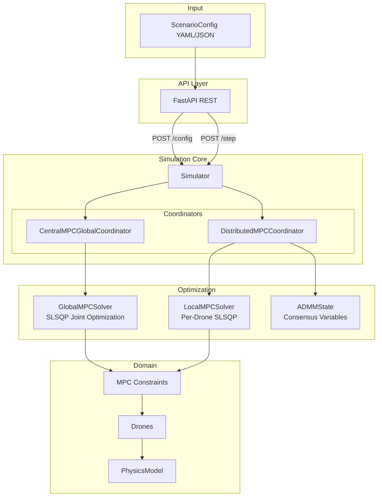
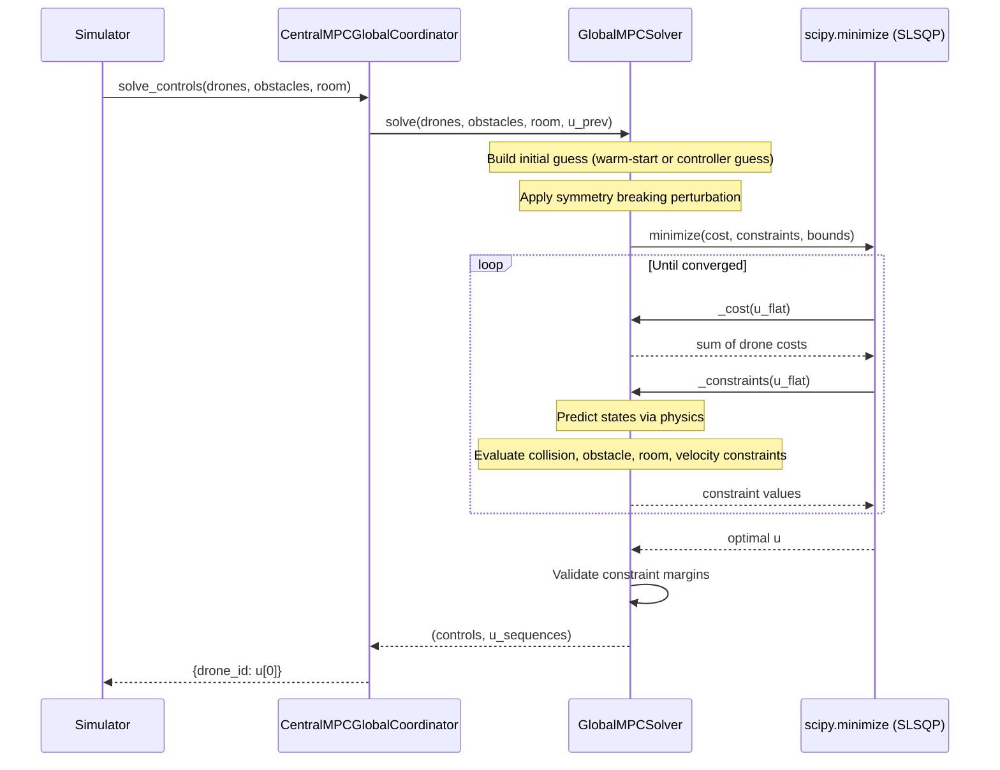
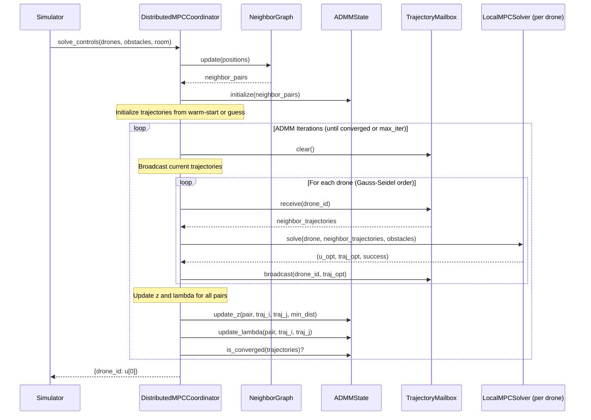
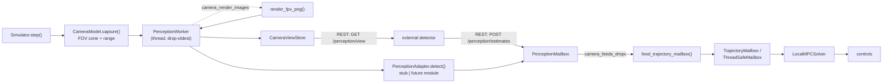

# TLCAmpc Architecture

This document describes the architecture and class structure of the **TLCAmpc** (Time-Linked Collision Avoidance MPC) drone simulation system.

## Overview

The system is a 3D drone simulation framework implementing Model Predictive Control (MPC) for collision avoidance. It supports both **centralized MPC** and **distributed MPC using ADMM consensus**.

## Package Structure

```
src/drone_sim/
├── domain/          # Core domain models & configuration
├── physics/         # Physics models for drone dynamics
├── controllers/     # MPC controllers (cost functions)
├── simulation/      # Simulation orchestration
│   ├── centralized/ # Centralized MPC coordinator
│   └── distributed/ # Distributed ADMM-based MPC
├── perception/      # Camera perception pipeline (see "Perception Pipeline")
└── api/             # FastAPI REST interface
```

## Class Diagram

```mermaid
classDiagram
    direction TB

    %% ===== DOMAIN LAYER =====
    class Drone {
        +drone_id: str
        +radius: float
        +safety_zone: float
        +alpha: float
        +controller: Controller
        +physics: PhysicsModel
        +x: ndarray
        +route: Route
        +position() ndarray
        +velocity() ndarray
        +predict(u) ndarray
        +compute_adaptive_radius(velocity) float
    }
    class Route {
        +waypoints: list
        +target: ndarray
        +waypoint_radius: float
        +idx: int
        +current_ref() ndarray
        +advance_if_reached(position)
        +target_reached(position) bool
    }
    class ScenarioConfig {
        +dt: float
        +physics: PhysicsSpec
        +controller: ControllerSpec
        +coordinator: ControllerSpec
        +comm_radius: float
        +drones: list
        +obstacles: list
        +room: RoomConfig
    }
    class DroneConfig {
        +drone_id: str
        +start: list
        +target: list
        +waypoints: list
        +radius: float
        +safety_zone: float
        +alpha: float
    }
    class registry_physics {
        +PHYSICS: dict
        +register(name)
        +create(spec) PhysicsModel
    }
    class registry_controller {
        +CONTROLLERS: dict
        +register(name)
        +create(spec) Controller
    }
    class registry_coordinator {
        +COORDINATORS: dict
        +register(name)
        +create(spec) object
    }

    Drone --> Route : has
    Drone --> Controller : uses
    Drone --> PhysicsModel : uses
    ScenarioConfig --> DroneConfig : contains
    registry_physics ..> PhysicsModel : creates
    registry_controller ..> Controller : creates
    registry_coordinator ..> CentralMPCGlobalCoordinator : creates
    registry_coordinator ..> DistributedMPCCoordinator : creates

    %% ===== PHYSICS LAYER =====
    class PhysicsModel {
        <<abstract>>
        +dt: float
        +v_max: float
        +step(x, u) ndarray
        +central_bounds() tuple
    }
    class LinearKinematicsPhysics {
        +A: ndarray
        +B: ndarray
        +step(x, u) ndarray
        +clip_velocity(vel) ndarray
    }

    PhysicsModel <|-- LinearKinematicsPhysics

    %% ===== CONTROLLER LAYER =====
    class Controller {
        <<abstract>>
        +control(drone, neighbors, obstacles) ndarray
    }
    class CentralCostProvider {
        <<protocol>>
        +dt: float
        +central_initial_guess(drone) ndarray
        +central_cost(u_seq, drone) float
    }
    class CentralMPCAgent {
        +dt: float
        +horizon: int
        +q_pos: list
        +q_vel: list
        +r_u: list
        +central_cost(u_seq, drone) float
        +central_initial_guess(drone) ndarray
    }
    class AdaptiveMPCAgent {
        +lambda_vel: float
        +central_cost(u_seq, drone) float
    }

    Controller <|-- CentralMPCAgent
    CentralCostProvider <|.. CentralMPCAgent
    CentralMPCAgent <|-- AdaptiveMPCAgent

    %% ===== CONSTRAINTS =====
    class MPCConstraints {
        <<abstract>>
        #_horizon: int
        +label() str
    }
    class VelocityConstraints {
        +evaluate_single(drone, v_pred, values) ndarray
        +evaluate_multi(drones, v_pred, values) ndarray
    }
    class MovingObstacleAvoidanceConstraints {
        +evaluate_single(drone, pred_pos, neighbors, values) ndarray
        +evaluate_multi(drones, pred_pos, values) ndarray
    }
    class ObstacleAvoidanceConstraints {
        +evaluate_single(drone, pred_pos, obstacles, values) ndarray
        +evaluate_multi(drones, pred_pos, obstacles, values) ndarray
    }
    class RoomConstraints {
        +wall_tolerance: float
        +evaluate_single(drone, pred_pos, room_max, room_min, values) ndarray
        +evaluate_multi(drones, pred_pos, room_max, room_min, values) ndarray
    }

    MPCConstraints <|-- VelocityConstraints
    MPCConstraints <|-- MovingObstacleAvoidanceConstraints
    MPCConstraints <|-- ObstacleAvoidanceConstraints
    MPCConstraints <|-- RoomConstraints

    %% ===== SIMULATION LAYER =====
    class Simulator {
        +dt: float
        +drones: list
        +obstacles: list
        +room_min: ndarray
        +room_max: ndarray
        +coordinator: object
        +t: float
        +step_count: int
        +from_config(cfg) Simulator
        +step()
        +to_dict() dict
    }

    Simulator --> Drone : manages
    Simulator --> CentralMPCGlobalCoordinator : uses
    Simulator --> DistributedMPCCoordinator : uses

    %% ===== CENTRALIZED MPC =====
    class CentralMPCGlobalCoordinator {
        +dt: float
        +horizon: int
        +max_iter: int
        +solve_controls(drones, obstacles, room_min, room_max) dict
    }
    class GlobalMPCSolver {
        +dt: float
        +horizon: int
        +max_iter: int
        +f_tol: float
        +solve(drones, obstacles, room_min, room_max, u_prev) tuple
        -_cost(u_flat, drones, controllers) float
        -_constraints(u_flat, drones, obstacles, room) ndarray
        -_predict_states(drones, u) ndarray
    }

    CentralMPCGlobalCoordinator --> GlobalMPCSolver : uses
    GlobalMPCSolver --> MPCConstraints : uses

    %% ===== DISTRIBUTED MPC =====
    class DistributedMPCCoordinator {
        +dt: float
        +horizon: int
        +rho: float
        +max_admm_iter: int
        +comm_radius: float
        +gauss_seidel: bool
        +solve_controls(drones, obstacles, room_min, room_max) dict
        +get_last_iteration_count() int
        +get_neighbor_pairs() list
    }
    class LocalMPCSolver {
        +dt: float
        +horizon: int
        +max_iter: int
        +solve(drone, neighbor_trajectories, obstacles) tuple
        -_predict_states(drone, u) tuple
        -_infeasible_fallback(drone, u_opt, traj_opt) tuple
    }
    class NeighborGraph {
        +comm_radius: float
        +update(positions)
        +get_neighbors(drone_id) set
        +get_neighbor_pairs() list
    }
    class ADMMState {
        +rho: float
        +primal_tol: float
        +dual_tol: float
        +horizon: int
        +initialize(neighbor_pairs)
        +update_z(pair, traj_i, traj_j, min_dist)
        +update_lambda(pair, traj_i, traj_j)
        +is_converged(trajectories) bool
        +compute_residuals(trajectories) tuple
    }
    class TrajectoryMailbox {
        +broadcast(sender_id, trajectory, timestamp, neighbor_graph)
        +receive(receiver_id) dict
        +clear()
    }
    class TrajectoryMessage {
        +drone_id: str
        +trajectory: ndarray
        +predicted_velocities: ndarray
        +timestamp: int
    }

    DistributedMPCCoordinator --> LocalMPCSolver : creates per drone
    DistributedMPCCoordinator --> NeighborGraph : uses
    DistributedMPCCoordinator --> ADMMState : uses
    DistributedMPCCoordinator --> TrajectoryMailbox : uses
    LocalMPCSolver --> MPCConstraints : uses
    TrajectoryMailbox --> TrajectoryMessage : stores

    %% ===== API LAYER =====
    class FastAPIApp {
        +/health
        +/config POST
        +/step POST
        +/state GET
        +/render GET
    }
    class StateResponse {
        +t: float
        +dt: float
        +room: RoomState
        +drones: list
        +obstacles: list
        +collisions: list
        +admm_stats: ADMMStats
    }

    FastAPIApp --> Simulator : manages
```



## Component Overview

### 1. Domain Layer (`domain/`)

| Class | Purpose |
|-------|---------|
| `Drone` | Core entity representing a drone with state, physics, controller, and route |
| `Route` | Manages waypoints and target positions for navigation |
| `ScenarioConfig` | Pydantic model for YAML/JSON scenario configuration |
| `DroneConfig` | Per-drone configuration (start, target, safety zone, etc.) |
| `Registry` | Factory pattern for creating physics/controllers/coordinators by name |

### 2. Physics Layer (`physics/`)

| Class | Purpose |
|-------|---------|
| `PhysicsModel` | Abstract base for drone dynamics |
| `LinearKinematicsPhysics` | Discrete-time constant-acceleration model (x_{k+1} = Ax_k + Bu_k) |

### 3. Controllers Layer (`controllers/`)

| Class | Purpose |
|-------|---------|
| `Controller` | Abstract base for per-drone controllers |
| `CentralMPCAgent` | MPC cost function for centralized optimization (tracking + control effort) |
| `AdaptiveMPCAgent` | Extended cost with velocity penalty for adaptive safety zones |

### 4. Constraints (`domain/constraints.py`)

| Class | Purpose |
|-------|---------|
| `VelocityConstraints` | Enforces v_max speed limits |
| `MovingObstacleAvoidanceConstraints` | Inter-drone collision avoidance (distance ≥ sum of safety zones) |
| `ObstacleAvoidanceConstraints` | Static obstacle avoidance |
| `RoomConstraints` | Room boundary constraints (box or sphere); every drone gets an extra terminal-radius (full braking distance) constraint at the last horizon step, switch `terminal_constraint` on the coordinators |

### 5. Simulation Layer (`simulation/`)

#### Core
| Class | Purpose |
|-------|---------|
| `Simulator` | Main orchestrator: loads config, runs time steps, manages drones |

#### Centralized MPC (`simulation/centralized/`)
| Class | Purpose |
|-------|---------|
| `CentralMPCGlobalCoordinator` | Wraps GlobalMPCSolver, provides solve_controls() interface |
| `GlobalMPCSolver` | Joint SLSQP optimization over all drones |

#### Distributed MPC (`simulation/distributed/`)
| Class | Purpose |
|-------|---------|
| `DistributedMPCCoordinator` | ADMM-based distributed coordinator |
| `LocalMPCSolver` | Per-drone SLSQP solver (neighbors as moving obstacles) |
| `NeighborGraph` | Tracks which drones are within comm_radius |
| `ADMMState` | Manages dual variables (λ) and auxiliary variables (z) |
| `TrajectoryMailbox` | In-memory message passing for trajectory exchange |

### 6. API Layer (`api/`)

| Component | Purpose |
|-----------|---------|
| `app.py` | FastAPI application with REST endpoints |
| `schemas.py` | Pydantic request/response models |
| `render.py` | Matplotlib-based PNG rendering |
| `perception_router.py` | Perception endpoints: the detector pulls camera images and pushes position estimates |

### 7. Perception Layer (`perception/`)

| Class | Purpose |
|-------|---------|
| `CameraModel` | Geometric visibility test (FOV cone + range) producing a `CameraView` per drone |
| `CameraView` / `VisibleDrone` | What one drone's camera sees at one step, optionally with a rendered PNG |
| `render_fpv_png` | Pinhole rasterizer (PIL): spheres, .obj meshes and obstacles, painter's algorithm |
| `PerceptionAdapter` | Protocol `detect(view) -> list[PositionEstimate]` — the seam an external detector plugs into |
| `StubPerceptionAdapter` | In-process stand-in: true positions of the visible neighbors plus optional Gaussian noise |
| `PerceptionWorker` | Runs render + detect off the simulation thread; drop-oldest queue, never blocks `step()` |
| `PerceptionMailbox` | Latest estimate and short history per (observer, observed) pair |
| `CameraViewStore` | One current `CameraView` per drone, waiting to be fetched over REST |
| `feed_trajectory_mailbox` | Bridge: turns estimates into extrapolated neighbor trajectories in the DMPC mailboxes |

## Data Flow Diagram



## MPC Optimization Flow

### Centralized MPC



### Distributed MPC (ADMM)



## Perception Pipeline

Normally every drone's DMPC inbox is filled by its neighbors *broadcasting* their optimized trajectories — perfect, instantaneous, complete knowledge. The perception pipeline replaces that source with what the drone's own **camera** could have seen. The image detector itself is developed separately and is not part of this package; what lives here is the seam it plugs into, plus an in-process stand-in to run the pipeline without it.



The pipeline is opt-in **twice**, and the two flags mean genuinely different things:

| Flag | Effect |
|------|--------|
| `camera_enabled` | Captures happen and the `PerceptionMailbox` fills. The control loop is untouched — perception observes, the DMPC still negotiates on true states. |
| `camera_feeds_dmpc` | The mailbox is handed to the coordinator, and neighbor trajectories come from estimates instead of broadcasts. |

Two backends supply the estimates. `camera_backend: "stub"` is the **in-process** path: `camera_adapter: "package.module:ClassName"` (plus optional `camera_adapter_params` as constructor keywords) names the detector class, which is imported and protocol-checked at scenario load — anything with `detect(view) -> list[PositionEstimate]` qualifies, no inheritance. Without that field the built-in `StubPerceptionAdapter` stands in (true positions of the visible neighbors, optionally plus Gaussian noise) — no network, deterministic at `camera_noise_sigma: 0`. `camera_backend: "rest"` parks each rendered view in the `CameraViewStore` instead: **the simulation is the server**, and the external detector pulls images from `GET /perception/view/{drone_id}` and posts its estimates to `POST /perception/estimates` (`api/perception_router.py`). The detector must echo the `captured_step` / `captured_time` it was given, otherwise the estimates cannot be placed on the simulation's time axis. Nothing in this package calls out to a foreign service.

**Feeding the DMPC changes the algorithm, not just the data.** ADMM negotiates by re-broadcasting; a camera does not renegotiate. The estimates are a fixed snapshot, so a second iteration would solve against identical neighbor data. Both distributed coordinators therefore run a **single pass** under perception — `DistributedMPCCoordinator` with `effective_max_iter = 1` and both re-broadcast points suppressed, `ThreadedMPCCoordinator` with one iteration per solver thread and the convergence poll skipped — and report `converged = True`, because there is nothing left to converge to. In the threaded case an empty inbox additionally has to *solve anyway*: an empty field of view is a legitimate state, not "the neighbors have not spoken yet".

Two consequences worth knowing when reading a perception run:

- **The camera does the routing, not the `NeighborGraph`.** The graph still runs on true positions, but it no longer decides what a drone knows — the visibility cone does. A neighbor outside the FOV or beyond `camera_range` is simply absent from the solve, and the drone plans as if it were not there.
- **Estimates lag by at least one step.** The capture in `step()` happens before the drones move, and with `camera_async: true` the detection lands even later. The bridge extrapolates at constant velocity (finite difference over the estimate history) to compensate part of it. With `camera_rate_steps > 1` the last estimate simply stays in place between captures.

Example scenarios: `configs/perception/4DronesDMPCPerception.json` (ADMM) and `configs/perception/2DronesThreadedPerception.json` (threaded). End-to-end tests: `tests/drone_sim/perception/test_perception_integration.py`.

## Key Design Patterns

1. **Registry Pattern**: Physics, controllers, and coordinators are registered by name and created dynamically from configuration specs.

2. **Strategy Pattern**: `PhysicsModel` and `Controller` are abstract bases allowing different implementations to be swapped.

3. **Coordinator Pattern**: Both `CentralMPCGlobalCoordinator` and `DistributedMPCCoordinator` implement the same `solve_controls()` interface, allowing the simulator to use either.

4. **Dataclass-based Design**: Extensive use of Python dataclasses for clean, typed data structures.

5. **Warm-Start**: Both coordinators maintain `_u_prev` for warm-starting subsequent optimizations.

## Adaptive Safety Zones

The system supports velocity-dependent adaptive safety radii:

```
r(t) = max(r_min, r_physical + α * ||v||² / (2 * U_max))
```

When `alpha` is set on a drone, the safety zone expands with velocity, encouraging deceleration near conflicts.
